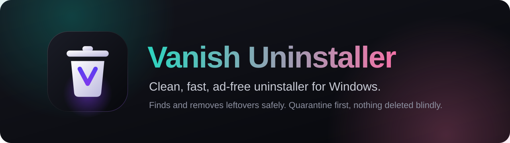
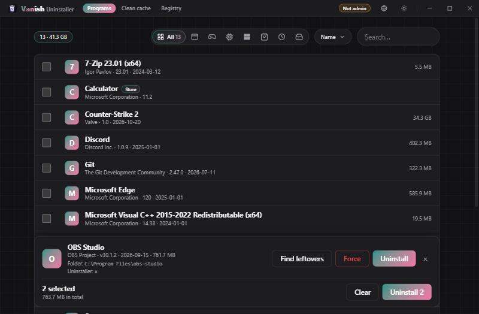
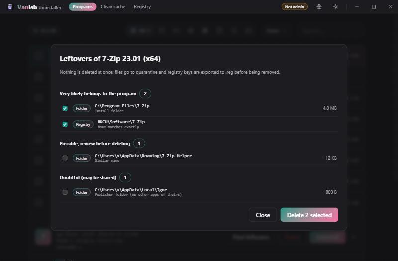
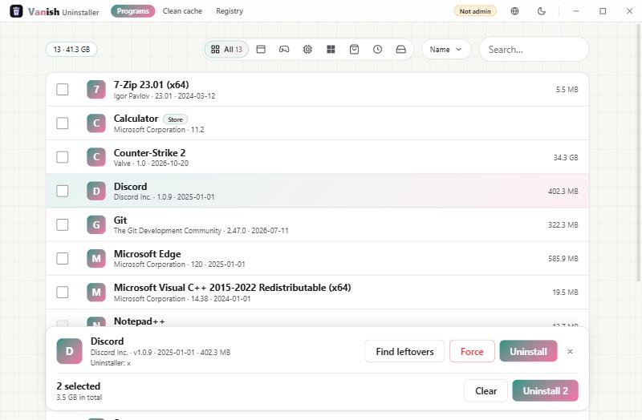
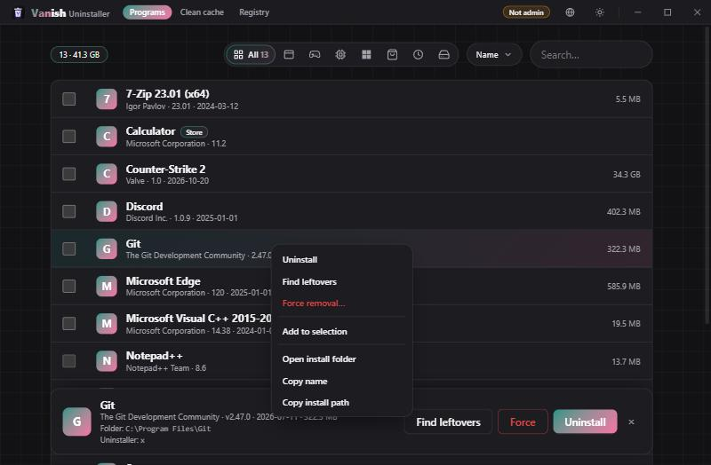
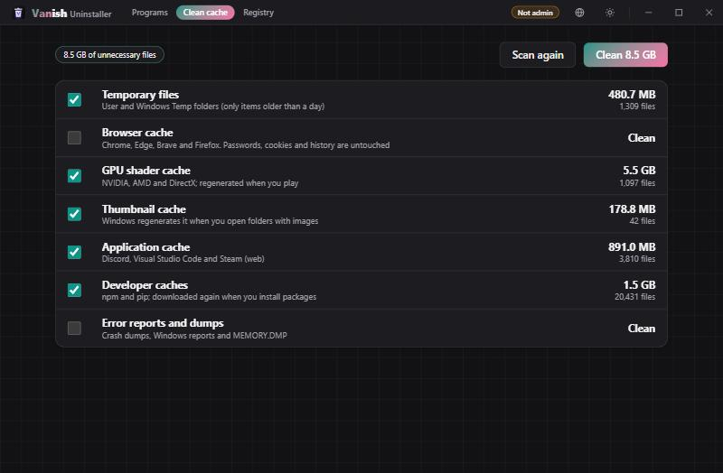
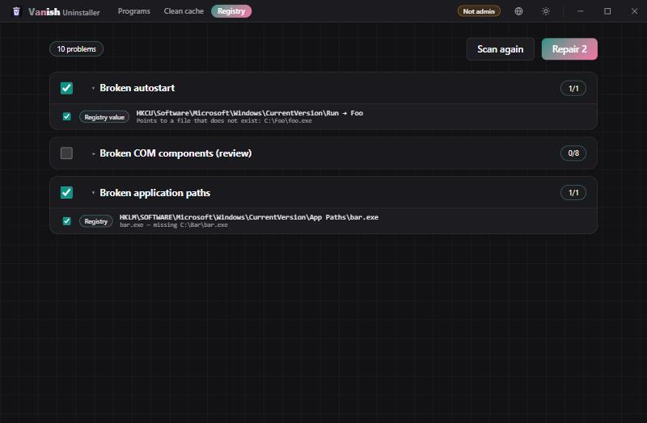
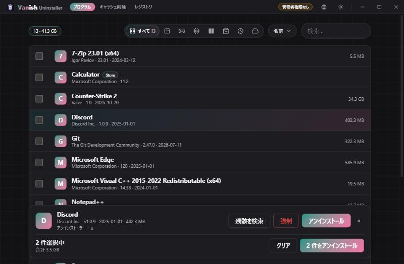

<p align="center">
  
</p>

<p align="center">
  <a href="../../releases/latest"></a>
  <a href="LICENSE"></a>
  
  
</p>

<p align="center">
  <b>A clean, fast, ad-free uninstaller for Windows.</b><br>
  It removes the program, then hunts down what it left behind, and never deletes anything blindly.
</p>

<p align="center">
  <a href="../../releases/latest"><b>Download</b></a> ·
  <a href="#features">Features</a> ·
  <a href="#how-it-stays-safe">Safety</a> ·
  <a href="#build-from-source">Build</a>
</p>

---

<p align="center">
  
</p>

> The interface speaks **English, Español, Português, 中文, 日本語 and 한국어**. It follows your system language and you can switch it any time with the globe button in the title bar.

## Why

Most uninstallers either look dated, nag you to install the vendor's other products, or delete leftovers with a heavy hand. Vanish Uninstaller is built around three ideas:

- **Light.** One ~3 MB executable. No services, no telemetry, no ads, no bundled offers.
- **Careful.** Anything that is not clearly the program's own is left unticked, and nothing is permanently deleted without a way back.
- **Pleasant.** A modern interface with light and dark themes, smooth motion and a compact layout.

## Features

| | |
|---|---|
| **Programs** | Everything in the registry (64-bit and 32-bit) plus Microsoft Store apps, with real icons, categories (apps, games, drivers and runtimes, Microsoft, Store, recent, large), search and sorting. |
| **Leftover scan** | After uninstalling, or with **forced removal** for broken uninstallers, it finds folders, files, registry keys and values, services, autostart entries and scheduled tasks. Each result has a confidence level and a reason. |
| **Batch uninstall** | Tick several programs and remove them one after another, then review all leftovers together. |
| **Cache cleaner** | Temp files, thumbnails, browser caches, GPU shader caches, app caches, developer caches (npm, pip), crash dumps and Windows Update leftovers. |
| **Registry cleaner** | Orphaned uninstall entries, broken App Paths, missing shared DLLs, broken autostart, stale MuiCache, broken COM classes and firewall rules. |
| **Details dock** | Select a program and a bottom panel shows its publisher, version, size, install folder and uninstall command, with the actions at hand. |
| **Context menu** | Right-click a program for uninstall, scan, force remove, select, open install folder and copy actions. |
| **6 languages** | English, Spanish, Portuguese (BR), Chinese (Simplified), Japanese and Korean. Detected automatically from Windows, switchable from the title bar. The installer is localized too. |
| **Portable or installed** | Use the standalone `.exe` or the NSIS installer. |

<table>
  <tr>
    <td width="50%"><br><sub><b>Leftovers by confidence.</b> Only the high-confidence ones are pre-selected.</sub></td>
    <td width="50%"><br><sub><b>Light theme</b> and batch selection.</sub></td>
  </tr>
  <tr>
    <td width="50%"><br><sub><b>Context menu</b> with only the actions that apply.</sub></td>
    <td width="50%"><br><sub><b>Cache cleaner</b> with sizes per category.</sub></td>
  </tr>
  <tr>
    <td width="50%"><br><sub><b>Registry cleaner.</b> Risky groups (COM, firewall) start unticked.</sub></td>
    <td width="50%"><br><sub><b>Your language.</b> Here in Japanese; the globe button switches instantly.</sub></td>
  </tr>
</table>

## How it stays safe

- **Ids, not paths.** Only items from the latest scan can be deleted, and they are referenced by id. The interface never sends a path to the backend.
- **Quarantine first.** Files and folders are moved to `%LocalAppData%\Vanish\quarantine` and purged after 7 days.
- **Registry backups.** Every key or value is exported to a `.reg` file before it is removed.
- **Confidence levels.** *High* is pre-selected, *medium* needs your review, *low* is shown but never ticked.
- **Protected list.** Windows folders, shared components and other protected names and paths are always skipped.
- **Still-installed check.** If an uninstaller was cancelled, the program's folder is not offered for deletion.
- **Honest scope.** The cache cleaner does delete permanently, but only inside its built-in categories.

## Install

Grab the latest build from the [**Releases**](../../releases/latest) page:

- `Vanish-Uninstaller_x.y.z_setup.exe`: installer.
- `Vanish-Uninstaller-portable.exe`: no installation needed.

**Requirements:** Windows 10 or 11 with the WebView2 runtime (included with Windows 11). The app asks for administrator rights on launch; without them it cannot touch `HKLM` or protected folders.

> The executables are not code-signed yet, so Windows SmartScreen may warn you. Choose **More info → Run anyway**.

## Build from source

You need [Node.js](https://nodejs.org), [Rust](https://rustup.rs) and the [Tauri prerequisites for Windows](https://tauri.app/start/prerequisites/).

```bash
npm install
npm run tauri dev      # run in development
npm run tauri build    # exe + NSIS installer in src-tauri/target/release
```

Backend tests:

```bash
cd src-tauri && cargo test
```

Outside Tauri, `npm run dev` serves the interface in a browser with sample data, which is handy for styling.

## Tech

[Rust](https://www.rust-lang.org) · [Tauri 2](https://tauri.app) · [Svelte 5](https://svelte.dev) · [Vite](https://vite.dev) · [`winreg`](https://crates.io/crates/winreg) · [`windows`](https://crates.io/crates/windows)

## Known limitations

- Scheduled tasks can only be read with administrator rights.
- There is no one-click restore from quarantine or from the `.reg` backups yet; restoring is manual.
- The portable build still stores its data in `%LocalAppData%\Vanish`.
- Store app removal has been tested on few real apps.

## License

[MIT](LICENSE) © 2026 Vulito
